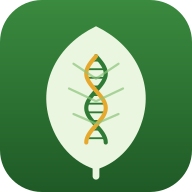

# FLORA 高校生物



図のラベル・用語カード・アニメーション・因果関係・系統樹と問題演習で、しくみから理解する高校生物アプリ（試作版 v0.1）。
[CELESTIA](https://github.com/kurowasan3/CELESTIA)（高校物理）・[ALCHEMIA](https://github.com/kurowasan3/ALCHEMIA)（高校化学）と同じ仕組み（復習・自動採点・同期・オフライン・問題管理表からの取り込み）で、シミュレーションの代わりに「学ぶ」の5つの機能を持っています。
iPhone・iPad・PC のブラウザで動き、ホーム画面に追加するとアプリとして使えます（PWA）。

## いまできること

- **学ぶ（5つの機能）**：解いた問題の「学ぶで確かめる」から、その内容のページが開く
  - **図へのラベル付け（17枚・123か所）**：動物細胞・植物細胞・ミトコンドリア・葉緑体・心臓・ネフロン・ニューロン・眼・耳・サルコメア・胚のう・葉の断面・DNA・脳・原腸胚・生体膜・花。「見る」「名前を答える」「位置を答える」の3通り。図はテーマ（ライト・ダーク）に合わせて塗り分ける
  - **用語・概念カード（1910語・36単元）**：用語 → 意味、意味 → 用語の両方向。「もう一度・あいまい・覚えた・かんたん」で、次に出す日を間隔反復（問題の復習と同じモデル）で決める。用語が出てくる図・アニメーションへのリンクつき。下のタブの「カード」からも開ける
  - **生命現象のアニメーション（11本）**：体細胞分裂・減数分裂（乗換え）・DNA の複製・転写と翻訳・活動電位・シナプスでの伝達・筋収縮・電子伝達系と ATP 合成・光合成・獲得免疫・カエルの発生。段階ごとに再生・一時停止・コマ送り・速さ変更。分裂は DNA 量、活動電位は膜電位のグラフが一緒に動く。「順に並べる」で段階の順番のクイズ
  - **因果関係の学習（13のしくみ・33問の予測）**：血糖濃度・体温・チロキシン・体液の浸透圧・ラクトースオペロン・種子の発芽・頂芽優勢・光周性・富栄養化・キーストーン種・HIV・電子伝達系・自然選択。「○○が増えたら何が増え、何が減る？」を予想して答え合わせすると、変化が伝わる矢印が順に光る。「つながりをたどる」で原因と結果を確認
  - **系統・分類・進化**：系統樹4つ（3ドメイン・動物・植物・脊椎動物）で形質がどの枝で獲得されたかを見る・当てる／地質時代の年表と「古い順に並べる」／集団遺伝（遺伝的浮動・自然選択のシミュレーションとハーディ・ワインベルグの比）／分類の階級
  - **法則・原理（14件）**：メンデルの法則・ハーディ・ワインベルグの法則・標識再捕獲法・伝導速度など（導出は1段ずつ開く）
- **8つの出題形式で入力して自動採点**：ホームの「形式ごとに演習」から選べる
  - 一問一答（語句。ひらがな・カタカナ・全角半角の違いを吸収）／正誤・選択（1つ・すべて）／順序・過程（タップして並べかえ）／因果関係（量ごとに「増える・減る・変わらない」）／図の名称（学ぶの図に ア・イ・ウ… の印）／計算（有効数字・比・分数）／実験考察／論述（自己採点）
- **問題 293問**：全36単元・基礎〜国公立2次（基礎 52・標準 118・入試基礎 85・国公立2次 38）。各単元7問以上。難関・最難関は問題管理表から取り込む前提
- **全分野からランダム／形式ごと／単元ごと／復習／検索／問題セット（3つ）**、自信度、定着度、ライト・ダーク、アカウントと同期、オフライン（CELESTIA・ALCHEMIA と同じ）
- マスコット：ミツバチの「メンデ」（名前はメンデルから。メンデルは修道院でミツバチも飼っていた）

## データの正しさを守る仕組み

学ぶのデータと問題は、次の検査を通らないとビルドが失敗します（`node tests/run.mjs`）。

- **因果の予測の答え**：答えは手で書かず、ネットワークの矢印の符号から計算する（いちばん短い経路の符号の積）。経路によって増減が食い違うもの・始点からたどれないものを聞いているとエラー。Python（`tools/biolib.py`）と JS（`js/learn.js`）の計算が一致するかも確かめる
- **図のピン**：図の外にないか、ピンどうしが近すぎて押せなくないか、ラベルが重複していないか。SVG の安全性（script・外部参照なし）
- **アニメーション**：段階の数が説明文（`content/bio/anims.json`）と描画プログラム（`js/anim.js`）で一致するか、すべての段階を NaN なしで描けるか
- **系統樹・年表**：1つの形質が1つの枝に決まるか、地質時代がつながっているか、できごとが時代の中で古い順か
- **反応式のつり合い**：問題文・解説の `\ce{…}` の反応式（呼吸・光合成・発酵など）で原子の数がつり合っているか
- **答えの整合**：すべての「入力用の答え」が読め、正解を入れると正解になるか

## フォルダ

```
content/                 正規データ（マスター。ここを編集する）
  taxonomy.json          分野 9（細胞と分子・代謝・遺伝情報・発生・体内環境・動物の反応と行動・植物の環境応答・生態と環境・進化と系統）・単元 36
  concepts.json  laws.json  misconceptions.json  tags.json  collections/
  bio/                   学ぶのデータ
    terms.json           用語カード（ID・用語・単元・意味）
    diagrams.json        図へのラベル付け（ピンの位置・名前・説明）。図は diagrams/*.svg
    anims.json           アニメーションの段階の名前と説明（描画は js/anim.js）
    causal.json          因果のネットワーク（ノード・符号つきの矢印・予測の問題）
    tree.json            系統樹・地質時代・分類の階級
  problems/<分野>/<問題ID>/problem.json
data/                    アプリ用（生成物。tools/build_data.py が作る。手で編集しない）
js/                      アプリ（app.js・learn.js（学ぶ）・anim.js（アニメーション）・catalog.js・answer.js（採点）・parser.js・sync.js …）
tools/                   変換・検査（biolib.py：因果の計算・系統樹／chemlib.py：反応式／import_items.py：問題管理表の取り込み）
tests/                   検査（node tests/run.mjs）
docs/data-spec.md        データ仕様
supabase/schema.sql      同期用の表（Supabase の SQL Editor で1回実行）
```

## 問題を追加・修正する

```sh
pip3 install jsonschema
python3 tools/build_data.py          # content/ → data/
node tests/run.mjs                   # 検査（全部 ✓ になればOK。--e2e でブラウザの通し操作も）
python3 tools/validate_content.py --write-golden   # 新しい問題ID を台帳に足す（問題を足したとき）
```

- `content/problems/<分野>/<新しい問題ID>/problem.json` を既存の問題をまねて作る（形と「入力用の答え」の書式は [docs/data-spec.md](docs/data-spec.md)）
- 問題ID は変えない・消さない。出さない問題は `quality.status` を `hidden` に
- 解いたあとに学ぶを開かせたいときは `"learn": {"page": "causal", "key": "glucose"}` のように書く
- 図の名称の問題は、学ぶの図（`content/bio/diagrams/*.svg`）の `<svg>` に `class="dg"` を付けてピンを足したものを使うと、テーマに合わせて塗られる

## 学ぶのデータを足す

- **用語**：`content/bio/terms.json` に `{id, term, unit, def}` を足す（id は `t` ＋ 3桁の続き番号。一度使った id は変えない＝カードの記録が id で残るため）
- **図**：`content/bio/diagrams/<ID>.svg` を描き、`diagrams.json` にピン `{x, y, label, note?, alt?, to?}` を書く（`to` は離れた位置を指す引き出し線）。塗りは `css/style.css` の「図（ラベル付け）」のクラス（`fcell`・`fn` など）を使う
- **因果のネットワーク**：`causal.json` にノード（`col` 列・`row` 行で配置）・矢印（`sign` は 1 か −1、フィードバックは `fb: true`）・予測の問題（`start` を `dir` だけ変えたとき `ask` のノードがどうなるか）を書く。答えは自動で計算される
- **アニメーション**：`js/anim.js` に描画（`{n: 段階の数, draw(s, u)}`）を書いて `ANIMS` に登録し、`anims.json` に段階の名前と説明を書く

## 問題管理表からの取り込み（難関・最難関）

CELESTIA・ALCHEMIA と同じ形式（1問1フォルダの `item.json`・`problem.svg`・`solution.svg`）で作った問題を取り込める。

```
python3 tools/import_items.py <content フォルダ> --sheet FLORA問題管理表.xlsx --verify <verify フォルダ>
python3 tools/build_data.py && python3 tools/validate_content.py --write-golden && node tests/run.mjs --e2e
```

- 問題ID は item.json の id をそのまま使う（同じ ID は上書き）。単元は単元名で決まる（`taxonomy.json` の名前。「遺伝」「呼吸」「ホルモン」などの略し方は `ALIASES` で吸収）
- 難易度 1〜5 → 基礎・標準・国公立2次・難関・最難関。科目（生物基礎／生物）は単元から自動で決まる（item.json の `course` で上書き可）
- item.json に `"format": "causal,written"` のように書くと、その出題形式に入る（qa・choice・order・causal・label・calc・experiment・written。無ければ論述）
- 入力採点はしない（自己採点）。自動採点にしたい小問は、取り込んだあと `answer.parts[].grading` を書き足す
- 問題 ID の分野の3文字は CEL・MET・GEN・DEV・HOM・RES・PLA・ECO・EVO

## アカウントと同期（Supabase）

- Supabase プロジェクトは **Lemma・CELESTIA・ALCHEMIA と共通**（`js/config.js` の値も同じ）。記録は別の表 `flora_state`
- 準備：`supabase/schema.sql` を SQL Editor で1回実行（表を1つ足すだけ）
- 用語カードの覚え具合（`cstat`）と学ぶの記録（`lrec`）も同期する（カードごとに新しい方・最高得点は高い方）
- 端末の保存キーは `flora.v1`・`flora.auth`、キャッシュ名は `flora-` で始まる（同じドメインの Lemma・ぶつりば・CELESTIA・ALCHEMIA と混ざらない・消し合わない）

## GitHub Pages で公開する

リポジトリ（`kurowasan3/FLORA`、Public）の直下にこのフォルダの中身を置き、Settings → Pages で `main` / `/ (root)` を選ぶ。

- 更新したときは `sw.js` の `VERSION`、各 JS の `FILE_VERSION`、`css/style.css` の `--flora-version` を同じ値に上げる
